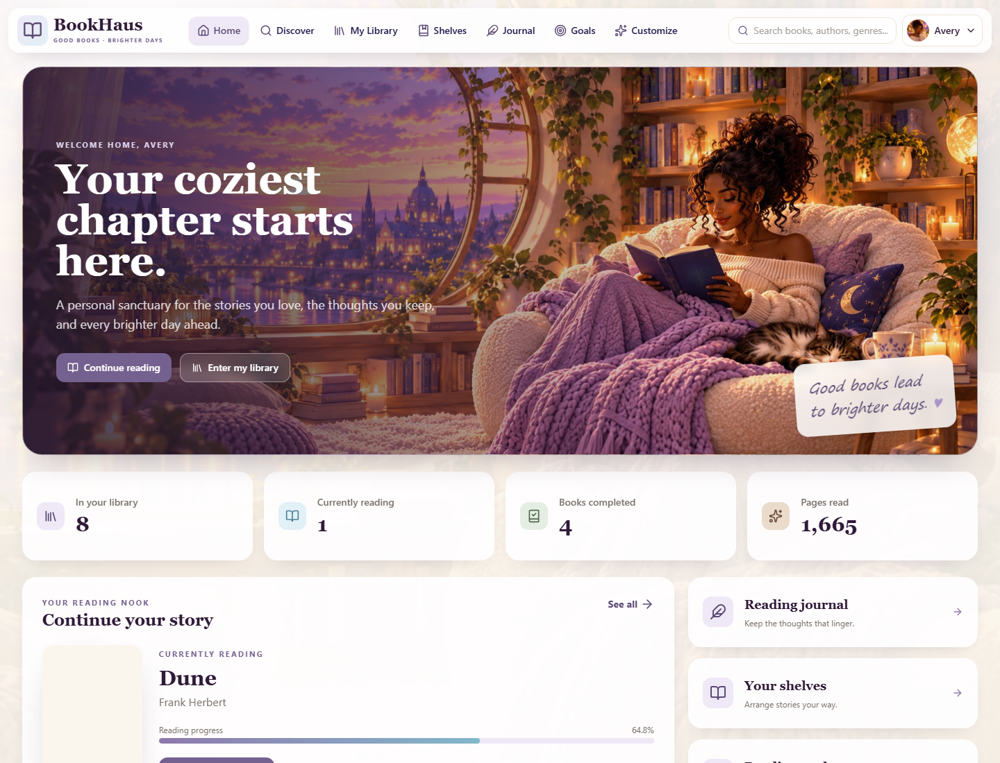
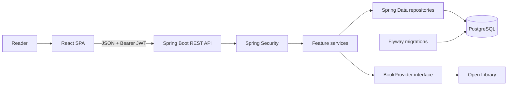
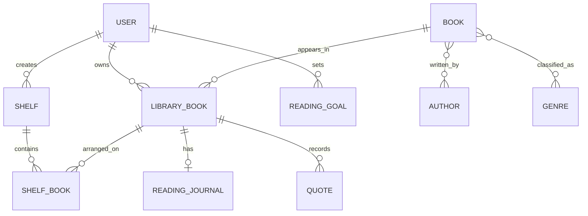
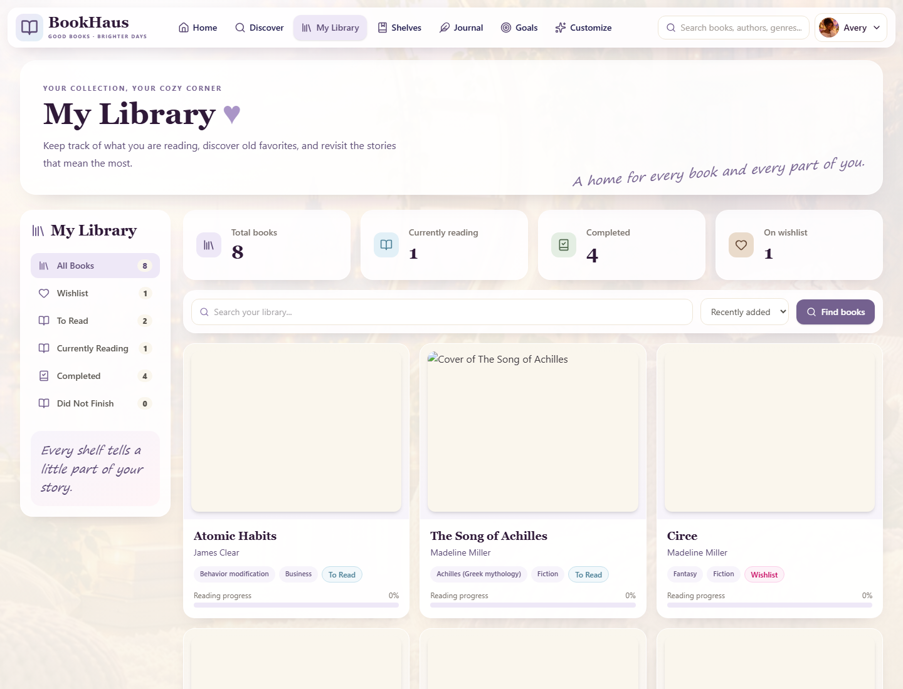
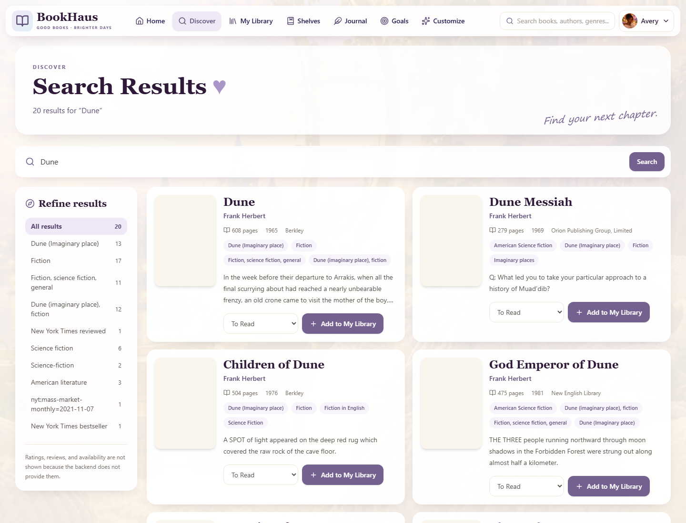
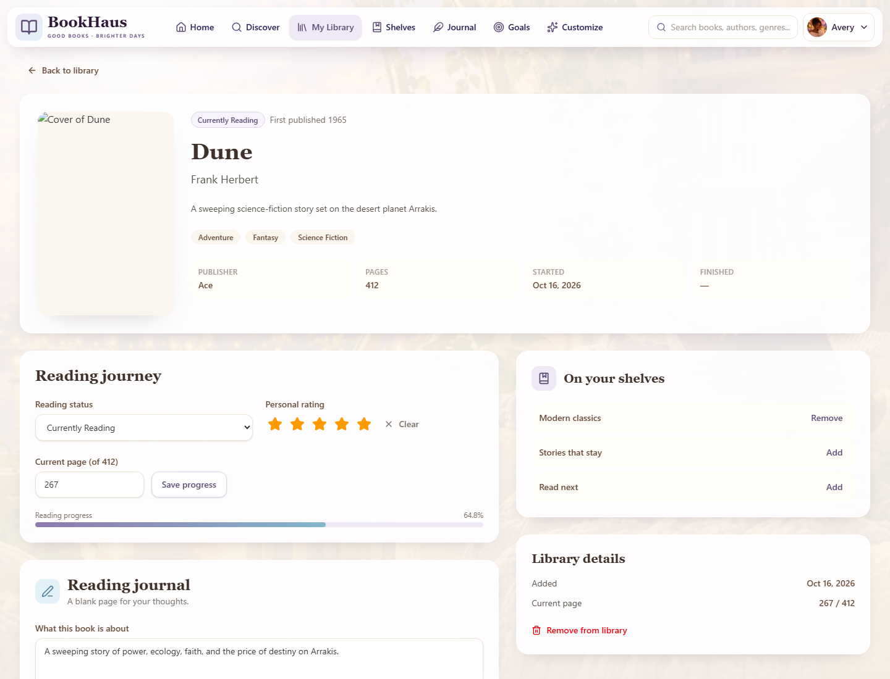
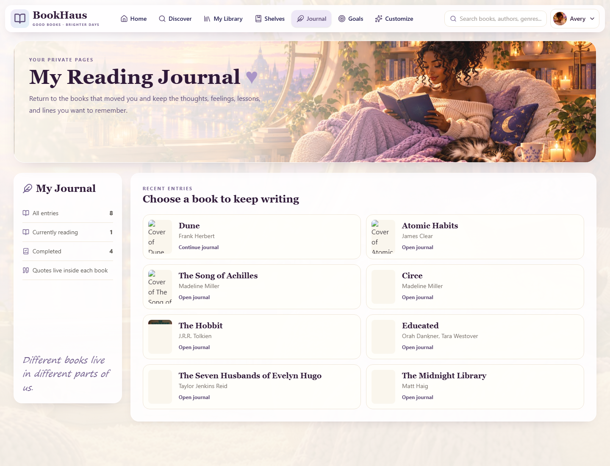
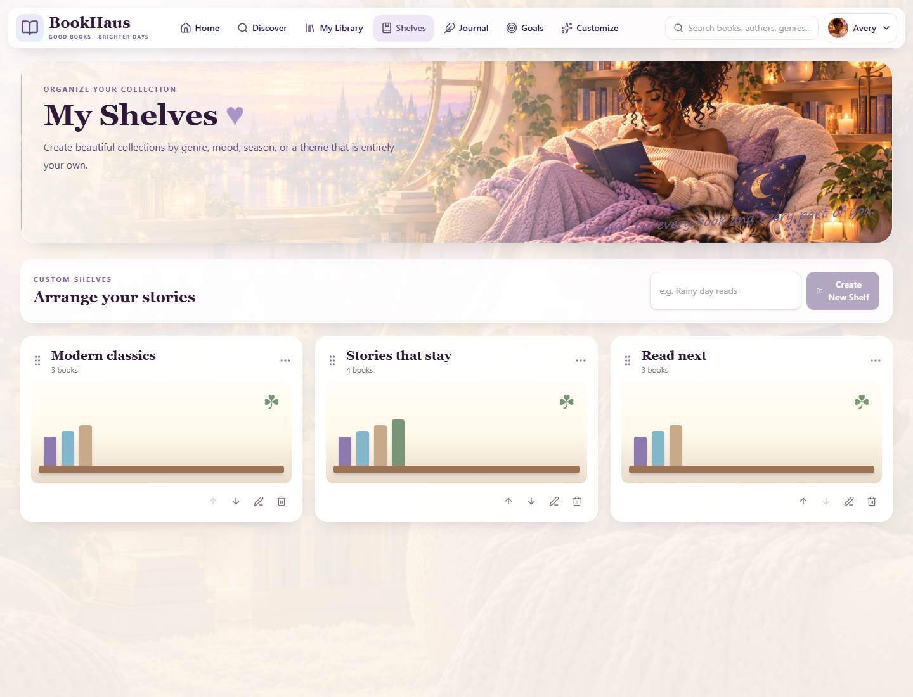
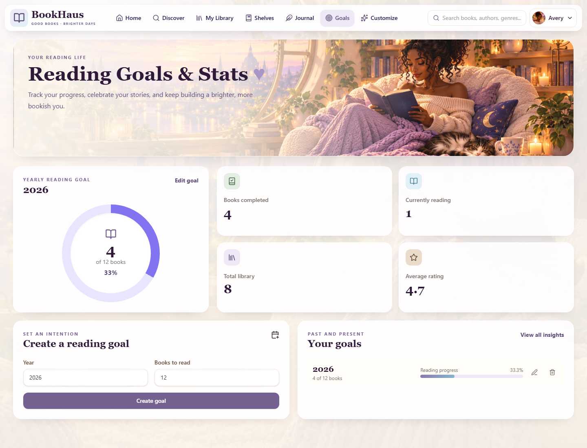
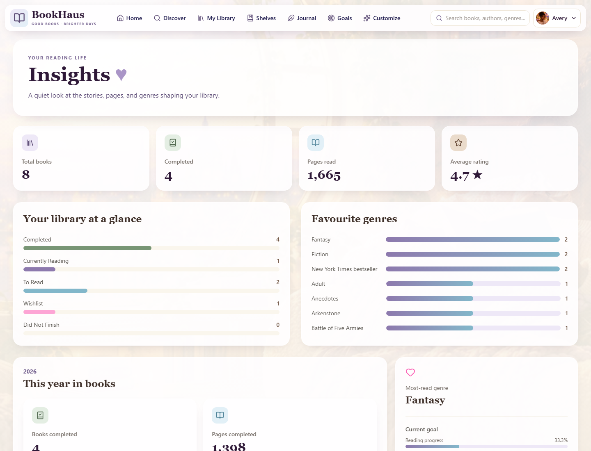

# BookHaus

> A full-stack personal reading companion for discovering books, organising a private library, recording reflections and measuring reading progress.




## Overview

BookHaus turns a reading list into a personal reading system. Readers can search Open Library, save books with an initial status, track pages and ratings, arrange custom shelves, keep private journal entries and quotes, set annual goals and explore derived insights. The project pairs a responsive React client with a secured Spring Boot API and a migration-managed PostgreSQL schema.

## What it demonstrates

- End-to-end product delivery across React, Spring Boot and PostgreSQL
- Stateless JWT authentication with user-scoped resource ownership
- A normalized relational model for books, authors, genres, shelves, journals, quotes and goals
- Third-party API integration behind an application-owned provider interface
- Derived analytics and goal progress calculated from source data
- Versioned Flyway migrations with Hibernate schema validation
- Accessible responsive UI states, consistent API errors and production-aware configuration
- Focused automated coverage across backend services, API boundaries and frontend behavior

## Features

| Area | Capabilities |
| --- | --- |
| Accounts | Registration, login, BCrypt password hashing, JWT sessions and current-user lookup |
| Discovery | Open Library search by title, author or subject with local DTO mapping |
| Personal library | Save books, filter by reading state, update progress, rate books and remove items |
| Reading states | Wishlist, to read, currently reading, completed and did not finish |
| Shelves | Create, rename, reorder and delete shelves without deleting library books |
| Journaling | One structured private journal per library book plus ordered favourite quotes |
| Goals | One annual target per year with derived completion, remaining count and pace |
| Insights | Library totals, pages read, average rating, status distribution and top genres |
| UX | Responsive layouts, loading skeletons, empty states, confirmations and accessible labels |

## Technology

### Backend

- Java 21 and Spring Boot 3.5.16
- Spring Web, Spring Security and Spring Data JPA
- JJWT 0.13 with BCrypt
- PostgreSQL and Flyway
- Jakarta Bean Validation, Lombok and Maven
- Spring `RestClient` for Open Library

### Frontend

- React 19 and React Router 7
- Vite 7
- Tailwind CSS 4 and custom CSS design tokens
- Lucide React icons
- Vitest, Testing Library and jsdom

### External service

- Open Library Search API for book discovery
- Open Library Covers API for cover URLs

### Tools

- Git and GitHub
- Maven and npm

## Architecture



The backend is packaged by feature. Controllers own HTTP concerns, services enforce business rules and ownership, repositories handle persistence and DTOs keep the API contract separate from JPA entities. The frontend centralizes HTTP behavior in API modules, stores its token in `sessionStorage` and protects application routes through authentication context.

### Authentication flow

1. A reader registers or signs in through a public authentication endpoint.
2. The API verifies credentials and returns a signed JWT plus a safe user projection.
3. The client stores the token for the browser-tab session.
4. Protected requests send `Authorization: Bearer <token>`.
5. The JWT filter restores the authenticated principal before a feature service runs.
6. Services derive ownership from that principal rather than accepting a client-supplied user ID.

## Domain model



`Book` represents reusable provider metadata. `LibraryBook` is the user-owned relationship that stores reading status, page progress, rating and dates. `ShelfBook` is an ordered join entity, which lets one library item appear on multiple shelves. Journals and quotes belong to a library item, while annual goals belong directly to a user.

## Application tour

The gallery pairs related workflows so the implemented product can be reviewed quickly. Discovery passes through the backend, personal state stays user-scoped and statistics are derived from source records.

| Personal library | Book discovery |
| --- | --- |
| Filter saved books by reading state and progress. | Search live Open Library results through BookHaus. |
|  |  |

| Book detail | Reading journal |
| --- | --- |
| Manage progress, rating, shelves, reflections and quotes. | Return to current and completed books for reflection. |
|  |  |

| Custom shelves | Reading goals |
| --- | --- |
| Group one library item into multiple ordered collections. | Track a yearly target against completed books. |
|  |  |

| Reading insights | Room customization |
| --- | --- |
| Review statuses, pages, ratings and favourite genres. | Preview and save local reading-room preferences. |
|  |  |

## Design direction

BookHaus uses warm cream surfaces, muted lavender accents, wood tones and soft bookish typography to create a calm reading-space identity. Warm lighting, restrained botanical details and dark-skinned reader representation carry that identity through the home, shelves, goals, journal and customization experiences.

## API

Authentication endpoints and the health check are public. Every other endpoint requires a valid Bearer token.

| Method | Endpoint | Purpose |
| --- | --- | --- |
| `POST` | `/api/auth/register` | Create an account and issue a JWT |
| `POST` | `/api/auth/login` | Authenticate and issue a JWT |
| `GET` | `/api/health` | Return the hosting health status |
| `GET` | `/api/users/me` | Return the authenticated user |
| `GET` | `/api/books/search?q={query}` | Search Open Library without persisting results |
| `GET` | `/api/books/{id}` | Return a locally persisted book |
| `POST` | `/api/library/books` | Add a provider result to the personal library |
| `GET` | `/api/library/books` | List the library, optionally filtered by status |
| `GET` | `/api/library/books/{id}` | Return one owned library item |
| `PATCH` | `/api/library/books/{id}/status` | Change reading status |
| `PATCH` | `/api/library/books/{id}/progress` | Update the current page |
| `PATCH` | `/api/library/books/{id}/rating` | Set or clear a personal rating |
| `DELETE` | `/api/library/books/{id}` | Remove an owned library item |
| `GET` | `/api/shelves` | List shelf summaries in display order |
| `GET` | `/api/shelves/{id}` | Return a shelf with ordered books |
| `POST` | `/api/shelves` | Create a shelf |
| `PATCH` | `/api/shelves/{id}` | Rename a shelf |
| `DELETE` | `/api/shelves/{id}` | Delete a shelf only |
| `POST` | `/api/shelves/{id}/books` | Add an owned library item to a shelf |
| `DELETE` | `/api/shelves/{id}/books/{libraryBookId}` | Remove a book from a shelf only |
| `PATCH` | `/api/shelves/reorder` | Reorder every shelf |
| `PATCH` | `/api/shelves/{id}/books/reorder` | Reorder every book on one shelf |
| `GET` | `/api/library/books/{id}/journal` | Return the book journal |
| `PUT` | `/api/library/books/{id}/journal` | Create or replace structured reflections |
| `GET` | `/api/library/books/{id}/quotes` | List quotes in creation order |
| `POST` | `/api/library/books/{id}/quotes` | Add a quote |
| `PATCH` | `/api/library/books/{id}/quotes/{quoteId}` | Update a quote |
| `DELETE` | `/api/library/books/{id}/quotes/{quoteId}` | Delete a quote |
| `POST` | `/api/goals` | Create an annual reading target |
| `GET` | `/api/goals` | List annual goals by year descending |
| `GET` | `/api/goals/{year}` | Return a goal with derived progress |
| `PATCH` | `/api/goals/{year}` | Change the annual target |
| `DELETE` | `/api/goals/{year}` | Delete an annual target |
| `GET` | `/api/stats` | Return overall reading insights |
| `GET` | `/api/stats/year/{year}` | Return completion totals for one year |

### Example

```http
POST /api/auth/login
Content-Type: application/json

{
  "email": "reader@example.com",
  "password": "your-password"
}
```

```http
GET /api/books/search?q=Dune
Authorization: Bearer <jwt-token>
```

The API returns consistent JSON errors for validation failures, conflicts, missing resources and authentication failures. It never accepts a user ID for personal-resource assignment.

## Database migrations

Flyway owns the schema lifecycle. Hibernate runs with `ddl-auto: validate`, so application startup fails if entities and migrations disagree.

| Version | Schema change |
| --- | --- |
| V1 | Users and unique email identity |
| V2 | Books, authors, genres and join tables |
| V3 | User-owned library books and reading state |
| V4 | Ordered shelves and shelf membership |
| V5 | Structured journals and quotes |
| V6 | Annual reading goals |
| V7 | Query indexes for provider lookup, library filters, ordering, quotes and goals |

Applied migrations are immutable. New schema changes should always be introduced through the next numbered migration.

## Local setup

### Prerequisites

- Java 21
- Maven 3.9 or newer
- PostgreSQL 15 or a compatible supported release
- Node.js 20.19 or newer and npm
- Git

### 1. Create the database

Create a PostgreSQL database named `bookhaus` and grant your local database user access.

### 2. Configure the backend

Copy the root example file and replace its placeholders:

```powershell
Copy-Item .env.example .env
```

```properties
DB_URL=jdbc:postgresql://localhost:5432/bookhaus
DB_USERNAME=your_postgres_user
DB_PASSWORD=your_postgres_password
JWT_SECRET=your_base64_encoded_secret_of_at_least_32_bytes
JWT_EXPIRATION=86400000
OPEN_LIBRARY_BASE_URL=https://openlibrary.org
FRONTEND_URL=http://localhost:5173
SPRING_PROFILES_ACTIVE=dev
```

Generate a suitable JWT secret in PowerShell:

```powershell
$bytes = New-Object byte[] 32
[System.Security.Cryptography.RandomNumberGenerator]::Fill($bytes)
[Convert]::ToBase64String($bytes)
```

### 3. Start the backend

```powershell
cd backend
mvn spring-boot:run
```

The API starts at `http://localhost:8080`. Flyway validates and applies pending migrations during startup.

### 4. Start the frontend

In another terminal:

```powershell
cd frontend
Copy-Item .env.example .env
npm install
npm run dev
```

Open `http://localhost:5173`.

## Environment variables

| Variable | Required | Purpose |
| --- | --- | --- |
| `DB_URL` | Yes | PostgreSQL JDBC URL |
| `DB_USERNAME` | Yes | Database username |
| `DB_PASSWORD` | Yes | Database password |
| `JWT_SECRET` | Yes | Base64-encoded signing key of at least 32 bytes |
| `JWT_EXPIRATION` | No | Token lifetime in milliseconds, defaults to one day |
| `OPEN_LIBRARY_BASE_URL` | No | Provider base URL, defaults to Open Library |
| `FRONTEND_URL` | No | Exact allowed browser origin, defaults to local Vite |
| `SPRING_PROFILES_ACTIVE` | No | `dev` locally or `prod` when deployed |
| `PORT` | No | Hosting platform port, with `SERVER_PORT` as a fallback |
| `VITE_API_BASE_URL` | No | Frontend API origin, blank uses the local Vite proxy |

Secrets belong in local or hosting-provider environment settings. Root `.env` files, frontend `.env` files, build output and dependencies are ignored by Git.

## Verification

```powershell
cd backend
mvn test
mvn package
```

```powershell
cd frontend
npm run lint
npm test
npm run build
```

The backend suite covers authentication, authorization, provider mapping and failures, library rules, ownership boundaries, shelves, journals, quotes, goals, statistics and error responses. The frontend suite covers authentication state, protected routing, API error normalization, filters, progress rendering, dialogs and key redesigned pages.

## Repository structure

```text
bookhaus/
|-- backend/
|   |-- src/main/java/com/bookhaus/
|   |   |-- auth/        # JWT authentication
|   |   |-- book/        # Catalog and Open Library integration
|   |   |-- goal/        # Annual goals and derived progress
|   |   |-- journal/     # Reflections and quotes
|   |   |-- library/     # User-owned books and reading state
|   |   |-- shelf/       # Ordered custom collections
|   |   |-- stats/       # Derived reading insights
|   |   `-- user/        # User identity
|   |-- src/main/resources/db/migration/
|   |-- src/test/
|   `-- pom.xml
|-- frontend/
|   |-- src/
|   |   |-- api/         # HTTP boundary
|   |   |-- components/  # Shared UI
|   |   |-- context/     # Authentication state
|   |   |-- layouts/     # Public and protected shells
|   |   `-- pages/       # Route-level features
|   |-- package.json
|   `-- vercel.json
|-- docs/
|   |-- screenshots/
|   |-- interview-notes.md
|   |-- portfolio.md
|   `-- social-preview.jpg
|-- scripts/capture-screenshots.mjs
|-- .env.example
`-- README.md
```

## Design decisions

- **User-owned join model:** A global book record is distinct from a reader's progress, rating and dates.
- **Provider boundary:** Open Library is accessed through `BookProvider`, so provider-specific mapping stays outside the domain.
- **Derived statistics:** Totals and goal progress are calculated from library data to avoid stale duplicated values.
- **Explicit shelf ordering:** Shelf and shelf-book positions are persisted and validated as complete reorder operations.
- **Session-scoped browser token:** `sessionStorage` keeps refreshes convenient while ending the client session with the tab.
- **Migration-first persistence:** Flyway changes structure and Hibernate validates it.
- **Honest metadata:** The UI does not invent ratings, reviews or availability that the backend does not provide.

## Current limitations

- The project does not yet provide OpenAPI documentation or generated API clients.
- Authentication uses one JWT rather than access and refresh token rotation.
- Search depends on Open Library availability and cover delivery.
- Reading sessions are not tracked, so yearly page totals conservatively count completed books.
- Reading-room preferences are stored only in the browser through `localStorage`.
- The application has no social features, recommendations engine or offline mode.
- Continuous integration is not configured yet.

## Future improvements

- Add OpenAPI documentation and contract checks
- Add CI for backend tests, frontend checks and production builds
- Introduce refresh-token rotation and account recovery
- Add reading-session history for richer time-based analytics
- Add provider caching, retry policy and observability
- Add end-to-end browser tests and automated accessibility checks

## Deployment

A low-complexity portfolio deployment can use Vercel for `frontend`, Render for `backend` and managed PostgreSQL on Render.

Backend settings:

```text
Root directory: backend
Build command:  mvn clean package -DskipTests
Start command:  java -jar target/bookhaus-0.0.1-SNAPSHOT.jar
Health path:    /api/health
```

Frontend settings:

```text
Root directory: frontend
Build command:  npm run build
Output:         dist
Environment:    VITE_API_BASE_URL=https://<backend-domain>
```

Set `SPRING_PROFILES_ACTIVE=prod`, configure the database and JWT variables, then set `FRONTEND_URL` to the exact deployed frontend origin. `frontend/vercel.json` preserves client-side routes by rewriting requests to `index.html`.

## Portfolio notes

See [docs/portfolio.md](docs/portfolio.md) for CV-ready bullets, repository metadata and the social-preview brief. See [docs/interview-notes.md](docs/interview-notes.md) for an interview-ready technical walkthrough.
